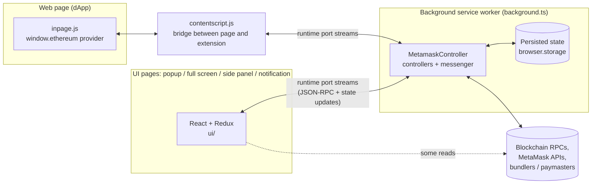
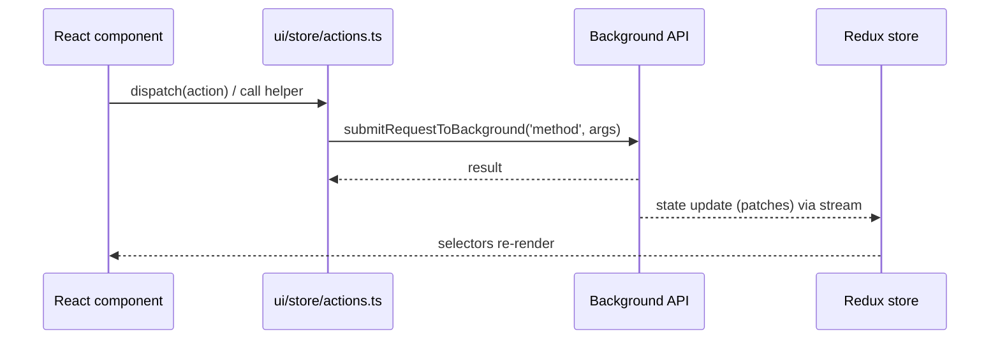
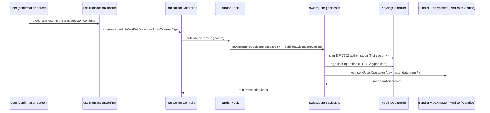
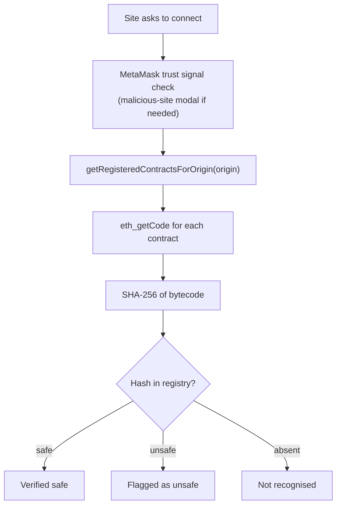
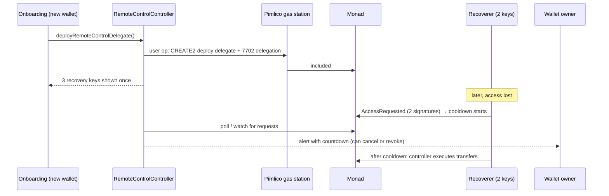
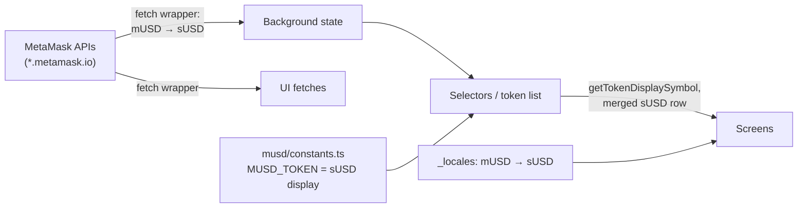

# Architecture

How Swissquote Wallet is built. The project is a fork of the MetaMask browser
extension: most of the code is MetaMask's, and Swissquote features are added as
a thin layer on top. This document first describes the inherited structure,
then each Swissquote addition, with its files and data flow.

For what the product does, see the [README](./README.md). For build and test
commands, see [docs/development-guide.md](./docs/development-guide.md).

---

## Contents

1. [Big picture](#1-big-picture)
2. [Background (service worker)](#2-background-service-worker)
3. [User interface](#3-user-interface)
4. [Shared code](#4-shared-code)
5. [Build system and configuration](#5-build-system-and-configuration)
6. [Swissquote layer](#6-swissquote-layer)
   - 6.1 [Gasless transactions](#61-gasless-transactions)
   - 6.2 [dApp contract check](#62-dapp-contract-check)
   - 6.3 [Wallet recovery](#63-wallet-recovery)
   - 6.4 [sUSD branding](#64-susd-branding)
   - 6.5 [Card](#65-card)
   - 6.6 [Theme and branding](#66-theme-and-branding)
   - 6.7 [Network and token-list behaviour](#67-network-and-token-list-behaviour)
   - 6.8 [Disabled MetaMask features](#68-disabled-metamask-features)
7. [Conventions for changing the code](#7-conventions-for-changing-the-code)
8. [File index of the Swissquote layer](#8-file-index-of-the-swissquote-layer)

---

## 1. Big picture

A Manifest V3 browser extension with four kinds of execution context:



| Context | Entry point | Role |
| --- | --- | --- |
| Background | `app/scripts/background.ts` | Owns all wallet state, keys (vault), controllers, network access and signing |
| UI | `ui/index.js` (loaded by `app/*.html` via `app/scripts/ui.ts`) | Renders state, sends user actions to the background |
| Content script | `app/scripts/contentscript.js` | Relays messages between web pages and the background |
| Inpage provider | `app/scripts/inpage.js` | Injects `window.ethereum` (EIP-1193 / EIP-6963) into pages |
| Offscreen document | `app/scripts/offscreen.ts` | Hosts APIs a service worker cannot use (hardware wallets, etc.) |

Keys never leave the background. The UI never holds private keys; it asks the
background to sign.

---

## 2. Background (service worker)

### 2.1 MetamaskController and the controller system

`app/scripts/metamask-controller.js` is the composition root. It creates every
controller (accounts, keyrings, networks, tokens, transactions, signatures,
permissions, swaps/bridge, …) and wires them together.

- **Controllers** extend `BaseController` (`@metamask/base-controller`) and
  hold a slice of state with per-field metadata (`persist`, `usedInUi`,
  `includeInStateLogs`, …). Most come from `@metamask/*-controller` packages;
  extension-specific ones live in `app/scripts/controllers/`.
- **Messenger.** Controllers talk to each other only through a typed messenger
  (`@metamask/messenger`): actions (`'TransactionController:updateTransaction'`)
  and events (`'NetworkController:stateChange'`). Each controller gets a
  restricted messenger listing exactly which actions and events it may use
  (`app/scripts/messenger-client-init/messengers/*`,
  `app/scripts/wallet-init/messengers/*`).
- **Initialisation** is declarative: each controller has an `*-init.ts` file
  (`app/scripts/messenger-client-init/`, `app/scripts/wallet-init/`) that
  builds it from its messenger and options and declares its persisted state
  key. The list of controllers is in
  `app/scripts/messenger-client-init/controller-list.ts`.

### 2.2 The UI-facing API

The UI calls background methods by name. They are exposed by
`LegacyBackgroundApiService` (`app/scripts/services/legacy-background-api-service.ts`)
and bound in `metamask-controller.js`. Examples: `setPreference`,
`addTransaction`, `setEnabledAllPopularNetworks`, `resetWallet`.

### 2.3 Transactions

`@metamask/transaction-controller` manages the transaction lifecycle
(add → approve → sign → publish → confirm). The extension customises it with
hooks in `app/scripts/lib/transaction/hooks/index.ts`:

- `publishHook`: decides *how* a signed (or externally signed) transaction is
  submitted: Swissquote gasless (§6.1), MetaMask Pay, the EIP-7702 relay,
  Smart Transactions, or a normal `eth_sendRawTransaction`.
- `beforeSign`, `beforePublish`, `afterAdd`: simulation enforcement,
  institutional snaps and metrics.

### 2.4 Persistence and migrations

State is persisted to `browser.storage.local` through the persistence manager
(`app/scripts/lib/setup-initial-state-hooks`, `app/scripts/lib/stores/`).
Format changes are handled by numbered migrations in `app/scripts/migrations/`.

### 2.5 Security inherited from MetaMask

- **LavaMoat** sandboxes every dependency in production builds
  (`lavamoat/webpack/*/policy.json`).
- **Phishing detection** (`PhishingController`), **Blockaid** transaction and
  signature simulation, and **trust signals** for sites
  (`ui/hooks/useOriginTrustSignals.ts`).
- **Permissions** (`PermissionController`) gate which sites can see accounts.

---

## 3. User interface

### 3.1 Stack

React (function components and hooks), Redux, React Router, the MetaMask design
system (`@metamask/design-system-react`) plus a legacy component library
(`ui/components/component-library`), and Tailwind
(`@metamask/design-system-tailwind-preset`).

### 3.2 Layout

```
ui/
  index.js          UI entry: connects to the background, creates the store
  store/            Redux store, actions.ts (all calls into the background)
  ducks/            Redux slices (metamask state mirror, app state, bridge, …)
  selectors/        Derived state (memoised with reselect)
  pages/            Routed screens (home, confirmations, onboarding, settings, …)
  components/       Reusable components (app/, multichain/, ui/, component-library/)
  hooks/            Shared hooks
  helpers/          Utilities and constants (routes.ts holds all route paths)
  css/              Global styles, design tokens, Swissquote theme
```

### 3.3 Talking to the background



`state.metamask` in Redux is a mirror of the background state (flattened
across controllers), kept in sync by patches from the background.

### 3.4 Routing

All paths are constants in `ui/helpers/constants/routes.ts`. The route tree is
in `ui/pages/routes/routes.component.tsx` (lazy-loaded pages). Confirmation
screens are routed by `ui/pages/confirmations/` based on pending approvals.

### 3.5 Translations

All user-facing strings use `t('key')` with messages in
`app/_locales/<lang>/messages.json` (English is the source of truth).

---

## 4. Shared code

`shared/` is imported by both background and UI:

- `shared/constants/`: chain IDs, networks, feature constants (including
  Swissquote: `swissquote.ts`, `remote-control.ts`, `susd.ts`).
- `shared/lib/`: pure utilities and selectors usable in both contexts
  (including `shared/lib/swissquote/` and `shared/lib/remote-control/`).
- `shared/types/`: shared TypeScript types.

---

## 5. Build system and configuration

- **Webpack** (`development/webpack/`). `yarn start` produces a development
  build in `dist/chrome` with file watching; `yarn dist` and `yarn build:test`
  produce production-like builds with LavaMoat.
- **Build-time variables** are read in this order of precedence: process
  environment → `.metamaskprodrc` → `.metamaskrc` → `builds.yml`
  (`development/webpack/utils/config.ts`), and exposed as `process.env.*`
  through `development/build/set-environment-variables.js`.
- **Plain-text imports:** a webpack rule (`asset/source`) imports `.txt`
  files as strings (used for the Swissquote contract registry). Jest maps them
  to `test/mocks/text-file.ts`; TypeScript types are in `types/txt.d.ts`.
- **Remote feature flags** come from MetaMask's config service at runtime
  (`RemoteFeatureFlagController`); some MetaMask features stay off unless
  MetaMask enables them.

---

## 6. Swissquote layer

### 6.1 Gasless transactions

**Goal:** let the user send any transaction without holding the native token,
with gas paid by a Swissquote-chosen sponsor, while keeping self-custody.

**Mechanism:** ERC-4337 user operations from the user's own EOA, upgraded with
EIP-7702 to the eth-infinitism `Simple7702Account` (EntryPoint v0.8). A
paymaster (gas station) pays; a bundler submits.



| Piece | File |
| --- | --- |
| Gas stations per network | `shared/constants/swissquote.ts` (`SWISSQUOTE_GAS_STATIONS`, `getSwissquoteGasStation`) |
| Monad gas station (Pimlico, API key from env) | `shared/constants/remote-control.ts` (`REMOTE_CONTROL_GAS_STATION`) |
| Routing in the publish hook | `app/scripts/lib/transaction/hooks/index.ts` |
| Gasless entry point (nonce handling, call building) | `app/scripts/lib/transaction/swissquote-gasless.ts` |
| User-operation engine (shared with recovery) | `app/scripts/lib/transaction/erc4337-user-operation.ts` |
| Gas selector UI | `ui/pages/confirmations/components/confirm/info/shared/gas-payment-selector/` |
| Opt-in preference (default "Pay gas fee") | `ui/pages/confirmations/hooks/gas/useGasSponsorshipPreference.ts` |
| Monad 10 MON reserve guard | `ui/pages/confirmations/hooks/gas/useMonadSponsorshipReserveBlock.ts` |
| Fee row label ("Paid by gas station") | `ui/pages/confirmations/components/confirm/info/shared/edit-gas-fees-row/edit-gas-fees-row.tsx` |
| Confirm-step flags | `ui/pages/confirmations/hooks/transactions/useTransactionConfirm.ts` |
| Insufficient-funds alert exemption | `ui/pages/confirmations/hooks/alerts/transactions/useInsufficientBalanceAlerts.ts` |
| Failure reason in Activity | `ui/pages/details/components/failure-reason.tsx` |

**Gas station types** (`erc4337-user-operation.ts`):
- *Service*: an ERC-7677 paymaster served from the same URL as the bundler
  (Candide, Pimlico with API key).
- *Contract*: a `SwissquoteGasStation` paymaster contract
  (`paymasterContract: true`) sent through a separate public bundler, with an
  allowlist check before sending. The contract and setup page live in
  `development/swissquote/gas-station/`; not active by default.

**Key decisions:**
- MetaMask's own relay ("Paid by MetaMask") is never used: it rejects these
  transactions. `useAutomaticGasFeeTokenSelect` is disabled for the same
  reason.
- The user operation does not use the EOA's transaction nonce, so the nonce the
  controller assigned is removed to avoid nonce gaps.
- Signing always goes through the `KeyringController`; private keys never leave
  the vault.

### 6.2 dApp contract check

**Goal:** a Swissquote-curated verdict on the code a dApp runs, independent of
the contract address.



| Piece | File |
| --- | --- |
| Registry (demo database) | `shared/lib/swissquote/swissquote-contract-registry.txt` |
| Parser, origin lookup, hashing, verdicts | `shared/lib/swissquote/swissquote-registry.ts` |
| Fetch + hash per contract (React hook) | `ui/hooks/swissquote/useSwissquoteContractChecks.ts` |
| Result popup | `ui/components/app/swissquote-verification/swissquote-verification-modal.tsx` |
| Connection gate (runs after MetaMask's check) | `ui/pages/permissions-connect/connection-trust-signal-gate/connection-trust-signal-gate.tsx` |

Registry format: `dapp <domain> <chainId> <address> [label]` lines map a site to
its contracts (subdomains match); `safe <sha256>` / `unsafe <sha256>` lines hold
verdicts. The hash is SHA-256 of the raw runtime bytecode from `eth_getCode`.

### 6.3 Wallet recovery

**Goal:** recover a wallet without the seed phrase, using two of three recovery
keys, with a delay the owner can use to cancel.

**On-chain:** `contract/RemoteControlDelegate.sol`, an EIP-7702 delegation
target. Storage lives in the EOA. Three key addresses are immutables. Two key
signatures (EIP-712 `AccessRequest`) grant a controller access after a
**5-minute cooldown**, valid for **one hour**. The EOA can `cancel()`,
`revoke()`, or remove the delegation entirely.



| Piece | File |
| --- | --- |
| Delegate contract | `contract/RemoteControlDelegate.sol` |
| Background controller (deploy, watch, block requests) | `app/scripts/controllers/remote-control/RemoteControlController.ts` |
| Init and messenger | `app/scripts/messenger-client-init/remote-control/`, `app/scripts/messenger-client-init/messengers/remote-control-controller-messenger.ts` |
| Key generation, CREATE2 initcode | `app/scripts/lib/remote-control/` |
| Contract constants (bytecode, ABI) | `shared/constants/remote-control-contract.ts` |
| Chain, gas station, timeouts | `shared/constants/remote-control.ts` |
| In-browser recovery logic | `shared/lib/remote-control/recover-wallet.ts` |
| Onboarding: deploy + show keys | `ui/pages/onboarding-flow/recovery-keys/` |
| Onboarding: recover a wallet | `ui/pages/onboarding-flow/swissquote-recovery/` |
| Access alert in the wallet | `ui/components/app/remote-control-access-alert/` |
| Command-line kit (delegate, unlock, controller, watcher) | `recovery-kit/` |
| Monitor controller (defined, not yet registered) | `app/scripts/controllers/monad-contract-monitor/` |

Only freshly created wallets get a delegate (imported or restored wallets are
excluded). Without `REMOTE_CONTROL_GAS_STATION_RPC_URL` the feature is inert.

### 6.4 sUSD branding

**Goal:** present MetaMask's mUSD stablecoin as "sUSD" (Swissquote USD)
everywhere, without changing what happens on-chain.



| Layer | File |
| --- | --- |
| Network rebranding of MetaMask API JSON (UI and background) | `shared/lib/swissquote/susd-branding.ts`, installed in `ui/index.js` and `app/scripts/background.ts` |
| Display constants and helpers (`MUSD_TOKEN`, `getTokenDisplaySymbol`) | `ui/components/app/musd/constants.ts` |
| Token list: symbol override and single merged sUSD row | `ui/components/app/assets/token-list/token-list.tsx`, `ui/components/app/assets/hooks/useTokenDisplayInfo.tsx` |
| Asset page name, symbol, icon | `ui/pages/asset/components/asset-page.tsx` |
| Translations | `app/_locales/*/messages.json` |
| Icon | `app/images/icons/susd.svg` |
| sUSD wrapper on Monad testnet (separate demo contract) | `shared/constants/susd.ts`, `ui/hooks/susd/useEnsureSusdToken.ts` |

Only exact JSON values (`"mUSD"`, `"MUSD"`, `"MetaMask USD"`) are rewritten;
addresses, amounts and IDs are untouched. Token *addresses and decimals* still
come from `@metamask/money-account-utils`.

### 6.5 Card

A home-screen **Card** tab (registered in
`ui/components/multichain/account-overview/account-overview-tabs.tsx`) showing
a mock card with show/hide details, a mock top-up dialog and a transactions
list. No backend; nothing is charged.

Files: `ui/components/app/card-tab/card-tab.tsx`,
`ui/components/app/card-tab/card-top-up-modal.tsx`.

### 6.6 Theme and branding

- **Design tokens.** MetaMask's design tokens are CSS variables;
  `ui/css/swissquote-theme.scss` (imported last in `ui/css/index.scss`)
  overrides them: orange primary, darker gain/loss colours, warm dark
  separators, Inter for display fonts, plus orange accents on the header
  hairline, active tabs and bottom navigation.
  Rule: the light block also matches `:root`, so every variable set there must
  be set again in the dark block.
- **Logo and icons:** `app/images/logo/` (the `metamask-fox.svg` file name is
  kept and holds the Swissquote mark), `app/images/icon-*.png`,
  `ui/components/ui/metafox-logo/horizontal-logo.js`.
- **Onboarding:** intro animation and backdrop
  (`ui/pages/onboarding-flow/welcome/metamask-wordmark-animation.tsx`,
  `fox-appear-animation.tsx`), welcome buttons (`welcome-login.tsx`), language
  picker (`ui/pages/onboarding-flow/onboarding-app-header/`), wallet-ready
  animation (`ui/pages/onboarding-flow/creation-successful/wallet-ready-animation.tsx`),
  Terms of Use (`ui/components/app/terms-of-use-popup/`).
- **Name:** `app/_locales/*/messages.json` (`appName`), manifests in
  `app/manifest/`.

### 6.7 Network and token-list behaviour

- **"All networks" includes test networks** when "Show test networks" is on:
  `LegacyBackgroundApiService.setEnabledAllPopularNetworks` →
  `#includeTestNetworksInAllNetworks` (uses
  `NetworkEnablementController:restoreEnabledNetworkMap`).
- **The "Show test networks" setting survives `resetWallet`** (wallet
  restore): `legacy-background-api-service.ts`.
- **Toggling the setting re-applies "All networks":**
  `setShowTestNetworksPreference` in `ui/store/actions.ts`.

### 6.8 Disabled MetaMask features

Switched off in code but not removed (see each file for the switch):

| Feature | Where |
| --- | --- |
| Money account | `shared/lib/money/feature-flags.ts` (`isMoneyAccountEnabled → false`) and removed routes |
| mUSD ads | removed from home and bottom navigation |
| Earn (staking link) | `StakeableLink` deleted |
| Explore DeFi button | `ui/components/app/assets/defi-list/cells/defi-empty-state.tsx` |
| Analytics opt-in onboarding step | `ui/pages/onboarding-flow/metametrics/metametrics-redirect.tsx` |
| MetaMask sponsorship relay in confirmations | see §6.1 |

Perps (MetaMask's Hyperliquid perpetuals) was restored and is enabled.

---

## 7. Conventions for changing the code

- **Follow [AGENTS.md](./AGENTS.md):** TypeScript for new files, function
  components, colocated tests, `oxfmt` formatting, Conventional Commits.
- **Keep Swissquote code identifiable:** comment changes to MetaMask files with
  `// Swissquote Wallet: …`, and put new modules under `swissquote` or
  feature-named folders. This makes upstream merges and reviews easier.
- **Colours:** use design tokens (`var(--color-primary-default)`, Tailwind
  token classes), not hex values, outside `swissquote-theme.scss`.
- **Background vs UI:** keys, signing and network-side logic belong in the
  background; the UI only calls the background API. Code needed by both goes
  in `shared/`.
- **Messenger permissions:** a controller or service calling a new action must
  list it in its restricted messenger.
- **Secrets:** API keys go in `.metamaskrc` (gitignored), never in source.
- **Dependencies:** after changes, run `yarn lavamoat:auto` and commit the
  policies.
- **Dev build:** restart `yarn start` after changing `.metamaskrc`, `builds.yml`
  or webpack config.

---

## 8. File index of the Swissquote layer

Files added by the fork (tests excluded):

| Path | Feature |
| --- | --- |
| `app/images/logo/swissquote-logo.svg`, `app/images/icons/susd.svg` | Branding |
| `app/scripts/controllers/remote-control/*` | Recovery |
| `app/scripts/controllers/monad-contract-monitor/*` | Recovery (not registered) |
| `app/scripts/lib/remote-control/*` | Recovery |
| `app/scripts/lib/transaction/erc4337-user-operation.ts` | Gasless, recovery |
| `app/scripts/lib/transaction/swissquote-gasless.ts` | Gasless |
| `app/scripts/messenger-client-init/remote-control/*`, `…/messengers/remote-control-controller-messenger.ts` | Recovery |
| `app/scripts/messenger-client-init/monad-contract-monitor/*` | Recovery (not registered) |
| `contract/RemoteControlDelegate.sol` | Recovery |
| `development/swissquote/gas-station/*` | Optional own gas station |
| `recovery-kit/*` | Recovery (CLI) |
| `shared/constants/swissquote.ts` | Gasless |
| `shared/constants/remote-control.ts`, `remote-control-contract.ts` | Recovery, gasless |
| `shared/constants/susd.ts` | sUSD |
| `shared/lib/remote-control/recover-wallet.ts` | Recovery |
| `shared/lib/swissquote/swissquote-registry.ts`, `swissquote-contract-registry.txt` | dApp check |
| `shared/lib/swissquote/susd-branding.ts` | sUSD |
| `shared/types/remote-control.ts` | Recovery |
| `test/mocks/text-file.ts`, `types/txt.d.ts` | Build support |
| `ui/components/app/card-tab/*` | Card |
| `ui/components/app/remote-control-access-alert/*` | Recovery |
| `ui/components/app/swissquote-verification/*` | dApp check |
| `ui/css/swissquote-theme.scss` | Theme |
| `ui/hooks/susd/useEnsureSusdToken.ts` | sUSD |
| `ui/hooks/swissquote/useSwissquoteContractChecks.ts` | dApp check |
| `ui/pages/confirmations/components/confirm/info/shared/gas-payment-selector/*` | Gasless |
| `ui/pages/confirmations/hooks/gas/useMonadSponsorshipReserveBlock.ts` | Gasless |
| `ui/pages/details/components/failure-reason.tsx` | Transactions |
| `ui/pages/onboarding-flow/metametrics/metametrics-redirect.tsx`, `use-next-route-after-metametrics-opt-in.ts` | Onboarding |
| `ui/pages/onboarding-flow/recovery-keys/*` | Recovery |
| `ui/pages/onboarding-flow/swissquote-recovery/*` | Recovery |

Main MetaMask files modified (search for `Swissquote Wallet` comments):
`app/scripts/lib/transaction/hooks/index.ts`,
`app/scripts/services/legacy-background-api-service.ts`,
`app/scripts/metamask-controller.js`, `app/scripts/background.ts`,
`ui/index.js`, `ui/store/actions.ts`, `ui/pages/routes/routes.component.tsx`,
`ui/helpers/constants/routes.ts`,
`ui/components/app/assets/token-list/token-list.tsx`,
`ui/components/app/wallet-overview/coin-buttons.tsx`,
`ui/components/multichain/account-overview/account-overview-tabs.tsx`,
`ui/pages/confirmations/hooks/transactions/useTransactionConfirm.ts`,
`ui/pages/confirmations/hooks/gas/useGasSponsorshipPreference.ts`,
`ui/pages/onboarding-flow/welcome/*`, `ui/css/index.scss`,
`development/webpack/webpack.config.ts`, `jest.config.js`.
